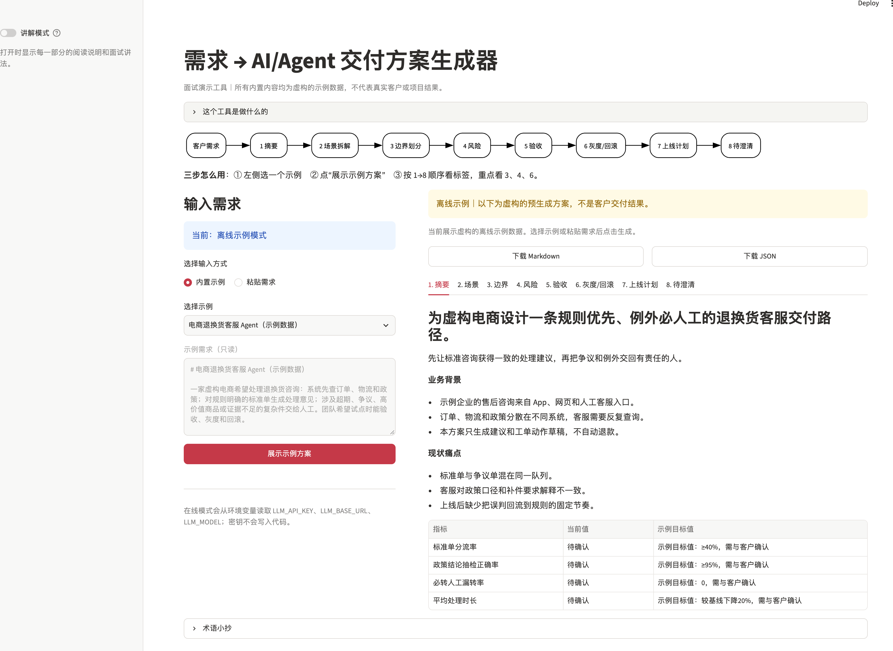
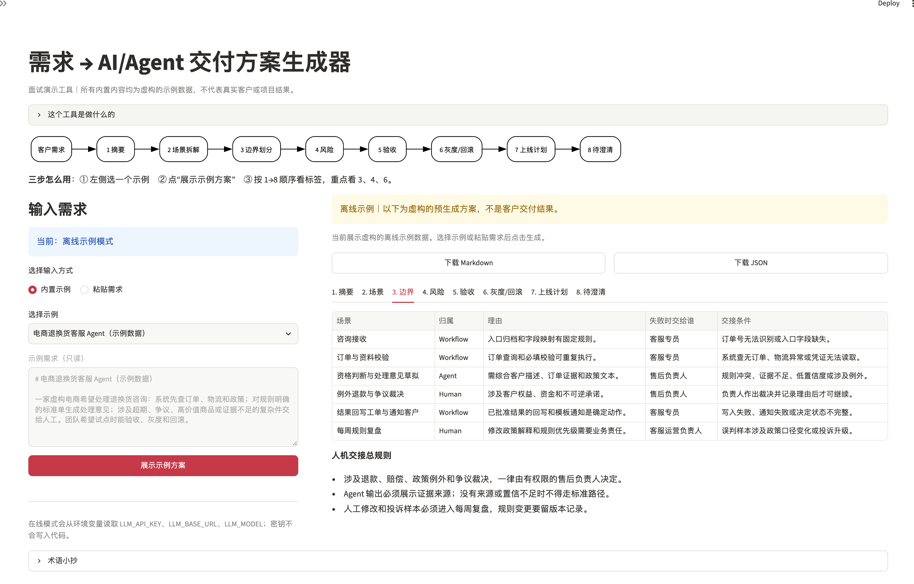
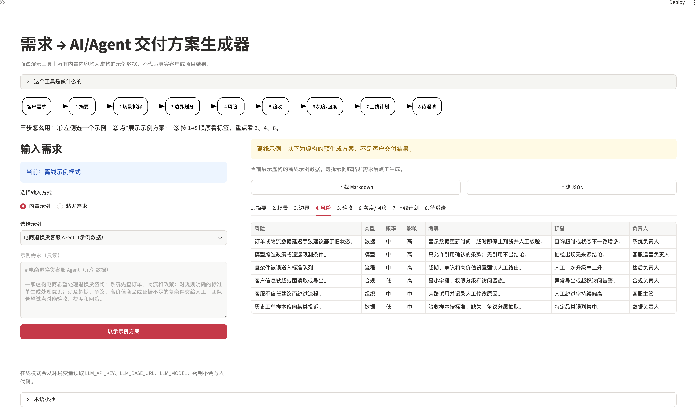

# 需求→交付方案生成器

一个本地运行的面试演示工具：把一段客户需求整理成可评审的 AI/Agent 交付方案，包括场景、Workflow / Agent / Human 边界、风险、验收、灰度、回滚与上线计划。

它解决的不是“模型能否回答”，而是 AI 方案如何进入真实交付：谁负责什么、何时必须人工接手、怎样验收、出问题怎么停。适合 AI 交付经理、项目经理、解决方案或业务团队在需求澄清/方案评审的早期使用。

> **示例数据声明**：所有内置示例及指标均为虚构的演示数据，不对应真实客户、真实项目或真实上线结果。

## 30 秒看懂

输入一段模糊的客户 AI 需求，得到一份从场景拆解、人机边界到验收、灰度和回滚的交付方案草稿。

```text
客户需求 → 1 摘要 → 2 场景拆解 → 3 边界划分 → 4 风险
        → 5 验收 → 6 灰度/回滚 → 7 上线计划 → 8 待澄清
```

三步怎么用：

1. 在左侧选择一个内置示例（所有内容均为虚构的「示例数据」）。
2. 点击「展示示例方案」。
3. 按 1→8 顺序阅读；面试演示时重点讲 3「边界」、4「风险」、6「灰度/回滚」。

首次打开默认开启「讲解模式」：每个标签有阅读说明和一段面试讲法。关闭侧栏中的讲解模式后，只保留方案本身，便于截图或导出。

## 界面截图

以下截图在本地运行应用后拍摄，并已关闭讲解模式。所有内容均为虚构的「示例数据」。

1. 首页：离线示例模式与输入区。



2. 「3. 边界」：Workflow / Agent / Human 分工表与交接条件。



3. 「4. 风险」：风险清单，含类型、缓解、预警和负责人。



## 面试演示脚本（3 分钟）

1. **开场（20 秒）**：这不是用 AI 自动写方案的玩具；它把一段模糊需求，先变成一张可和客户评审的交付清单。
2. **选示例（25 秒）**：选择「电商退换货客服 Agent（示例数据）」并展示。说明所有数字都是示例目标值，真正上线前必须和客户确认基线。
3. **讲边界（55 秒）**：打开「3. 边界」：订单校验这类固定规则交给 Workflow；综合证据形成建议交给 Agent；退款、争议和例外仍留给 Human。交接条件就是出错时谁接手。
4. **讲风险与灰度（55 秒）**：打开「4. 风险」和「6. 灰度/回滚」：风险必须有预警和负责人；先从内部、5%、30%观察，命中红线即切回人工，而不是直接全量。
5. **收尾（25 秒）**：这个工具的价值是先把“需求到能上线”中间最容易漏掉的边界、验收和回退路径摊开，再由客户决定哪些假设成立。

## 本地运行

需要 Python 3.11+。

```bash
cd /Users/fiona/Documents/编程项目/req-to-delivery-plan
python3.11 -m venv .venv
source .venv/bin/activate
pip install -r requirements.txt
cp .env.example .env
streamlit run app.py
```

浏览器打开 Streamlit 显示的本地地址即可。`.env` 已被 Git 忽略，不会被提交。

## 两种运行模式

### 离线示例模式（默认）

没有 `LLM_API_KEY` 时，页面进入「离线示例模式」。选择内置示例会直接读取 `examples/*.json`，完整展示 8 个部分；这适合面试现场断网或不便配置模型时演示。

内置的 3 个虚构场景：

1. 电商退换货客服 Agent
2. B2B 销售线索分级与跟进
3. 制造业报价助手

### 在线模式

把 `.env.example` 复制为 `.env` 后填写自己的兼容接口配置：

```dotenv
LLM_API_KEY=your_key_here
LLM_BASE_URL=https://api.openai.com/v1
LLM_MODEL=your_model_name
```

应用只从环境变量读取密钥；不会在代码、示例或 Git 提交中保存 key。检测到 `LLM_API_KEY` 时，粘贴任意需求并点击生成，会通过 OpenAI 兼容的 Chat Completions 接口请求 JSON。输出先经过 Pydantic schema 校验：失败会带着错误信息重试 1 次；再次失败则明确提示并回退为虚构的离线示例。

## 输出结构

| 部分 | 输出内容 |
| --- | --- |
| 1. summary | 业务背景、现状痛点、当前值与示例目标值 |
| 2. scenarios | 触发条件、输入、期望输出、频次/量级、涉及系统 |
| 3. boundary | 与场景一一对应的 Workflow / Agent / Human、理由和交接条件 |
| 4. risks | 数据、模型、流程、合规、组织风险及预警信号、负责人 |
| 5. acceptance | 指标定义、示例目标值、测试方法、样本量、通过标准 |
| 6. rollout | 灰度阶段、观察时长、负责人和至少三类回滚触发 |
| 7. launch_plan | 上线阶段、时间、交付物、参与方、退出标准 |
| 8. open_questions | 按业务、数据、系统、合规分组的问题 |

页面可下载 Markdown 和 JSON。下载结果是方案草稿，业务规则、阈值、指标和上线决定仍须由客户责任人确认。

## 与 Casebook 的关联

这个工具把 Casebook 的交付判断变成可操作的输入/输出：例如 [Case 06｜退换货客服 Agent 端到端交付](https://github.com/FionaHong-Lab/ai-agent-delivery-casebook/blob/main/case-06-return-refund-e2e-delivery.md) 强调的“规则优先、例外必人审、可验收、可灰度、可回滚”，被固定进 schema、提示词和离线示例中。

它不声称替代需求访谈或上线治理；它的作用是把第一版方案变成一张可讨论、可修改、可下载的交付清单。

## 已知局限与下一步

- 在线 JSON 依赖所选兼容接口支持 `response_format: json_object`；不支持时会回退到离线示例。
- 当前没有接入客户知识库、CRM、工单或权限系统；所有连接都需要单独定义数据最小化、权限和审计规则。
- 当前验收目标是建议模板，不能替代业务基线与责任人的确认。
- 下一步可加入：可编辑的规则/阈值面板、评测样本导入、版本对比、方案导出模板和脱敏审计记录。
